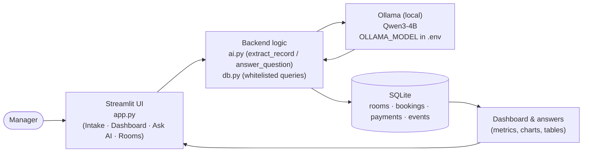
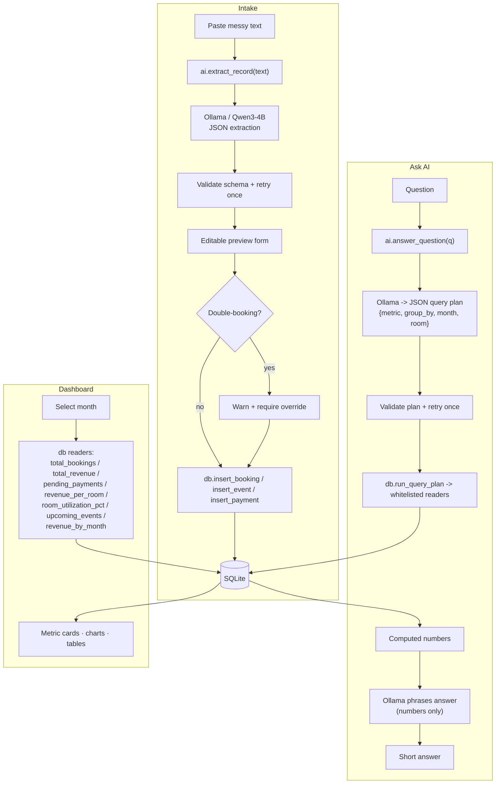
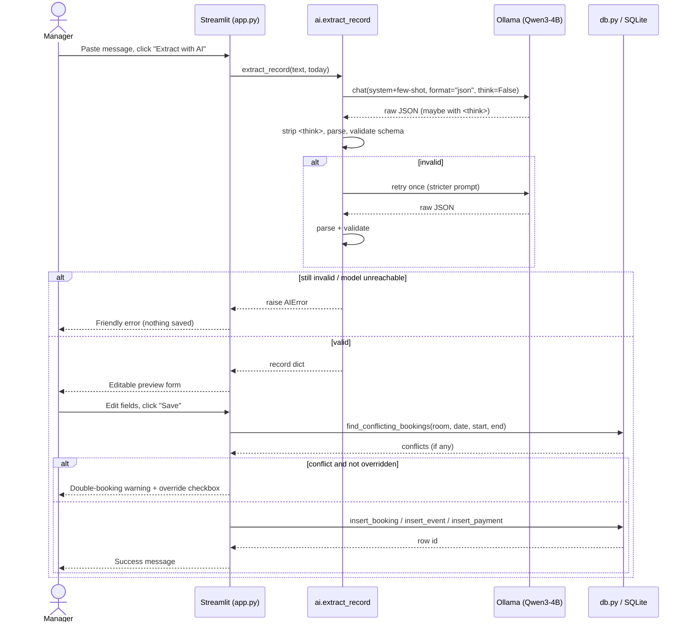

# CoworkOps AI

> An AI assistant that turns messy coworking-space messages into structured bookings, payments, and events — and answers plain-English questions about your data.

---

## Problem

Coworking space managers receive bookings, payments, and event requests as **messy text** — WhatsApp messages, quick notes, half-sentences in a mix of English and Roman Urdu. They end up tracking rooms, revenue, and events across scattered notes, so they can never get a clean, month-wise picture of how the space is doing.

## Solution & Features

The manager pastes any messy message. A small, locally-run LLM extracts the structured record; the manager confirms/edits it; it is saved to SQLite. A month-wise dashboard and a natural-language Q&A sit on top of that data.

**MVP features:**

1. **Smart Intake** — paste text → AI extracts `record_type` (booking / event / payment), name, room, date, start/end time, amount (PKR), payment status, event name, notes → review/edit in a form → save. Detects **double-bookings** (same room + overlapping time) and warns before saving.
2. **Rooms** — list of rooms with capacity and hourly rate (5 seeded rooms).
3. **Month-wise Dashboard** — month selector (defaults to October 2026); metric cards (total bookings, total revenue in PKR, pending payments, events), revenue-per-room bar chart, room utilization % (booked hours ÷ available hours, open 9am–9pm), upcoming-events table, and a month-over-month revenue line chart.
4. **Ask AI** — chat-style natural-language questions ("Which room was used least in October?") answered **only from your data**, with 5 clickable examples.
5. **Seed/demo data** — 5 rooms + realistic bookings, payments, and events for September & October 2026.

## AI Component

- **Model:** **Qwen3-4B** (4 billion parameters) — a small open-weight model (≤ 8B).
- **Runtime:** runs **locally via [Ollama](https://ollama.com)** — no cloud API, data stays on your machine.
- **Configurable:** the model name is read from `.env` (`OLLAMA_MODEL`, default `qwen3:4b`).

**What the model does (and what it is *not* allowed to do):**

| Feature | Model's job | Guardrail |
|---|---|---|
| Smart Intake | Convert messy text into a structured JSON record | Output validated against a schema; **one retry** on failure, then a friendly error. The manager confirms before anything is saved. |
| Ask AI | 1) Convert the question into a constrained **JSON query plan** `{metric, group_by, month, room}`. 2) Phrase a short answer **using only the numbers Python computed**. | The model **never writes SQL**. Python runs a **whitelist** of parameterized queries. Off-topic questions return "I can't answer that from your data" instead of a guess. |

Ollama **structured output** (`format="json"`) is used, and Qwen3 "thinking" mode is disabled (`think=False` / `/no_think`); any stray `<think>…</think>` text is stripped before parsing.

---

## Architecture



## Data Flow



## Sequence — Smart Intake



---

## Setup

**Prerequisites:** Python 3.10+ and [Ollama](https://ollama.com/download).

```bash
# 1. Install and start Ollama (see ollama.com for your OS), then pull the model:
ollama pull qwen3:4b
# Ensure the Ollama server is running (it usually starts automatically):
#   ollama serve

# 2. Get the code and install Python dependencies:
git clone <your-repo-url>
cd coworkops-ai
pip install -r requirements.txt

# 3. Configure the model name (optional — qwen3:4b is the default):
cp .env.example .env
#   .env contains: OLLAMA_MODEL=qwen3:4b

# 4. Seed the database with 5 rooms + demo data (Sep & Oct 2026):
python seed.py

# 5. Run the app:
streamlit run app.py
```

> The app also seeds automatically on first launch if the database is empty, so step 4 is optional. `.env` and the `*.db` file are git-ignored — **no secrets live in the repo**.

## Usage Example

**Smart Intake** — paste something like:

```
bilal bhai ne Team Room liya kal 11 baje se 1 baje, 3000 me se 1500 ada baqi pending
```

The AI extracts: `record_type: booking`, `name: Bilal`, `room: Team Room`, `date: <tomorrow>`, `start_time: 11:00`, `end_time: 13:00`, `amount_pkr: 3000`, `payment_status: pending`. Review, then **Save**. If Team Room already has an overlapping booking that day, you'll get a double-booking warning first.

**Ask AI** — type or click an example:

```
Which room made the most revenue in October 2026?
→ For October 2026, revenue by room was: Focus Room PKR 3,200, Team Room PKR 15,000,
  Conference Hall PKR 0, Quiet Pod PKR 2,500, Event Space PKR 96,000.
  The top earner was Event Space with PKR 96,000.
```

**Dashboard** — pick a month (defaults to October 2026) to see bookings, revenue, pending payments, events, the revenue-per-room bar chart, utilization %, and the month-over-month revenue trend.

## Testing & Findings

Run the suite:

```bash
pytest -v tests/      # 40 tests: db helpers, double-booking, query-plan execution, extraction parsing (model mocked)
pytest -s tests/      # also prints expected-vs-actual for the AI tests
```

Full, honestly-reported results — including what is and isn't covered — are in **[TEST_FINDINGS.md](TEST_FINDINGS.md)**. Latest run: **40 passed** on Python 3.11.15 / pytest 9.1.1.

## Known Limitations

- **Tests mock the LLM.** Automated tests verify our parsing, validation, retry, whitelisting, and phrasing logic — **not** the live model's extraction/planning quality. Spot-check real behavior against a running Ollama. (See TEST_FINDINGS.md.)
- **Double-booking detection skips records with missing times** — a booking with no start/end time can't be compared, so some overlaps may go undetected.
- **Utilization % uses a flat assumption** — available hours = days-in-month × 12 (9am–9pm), with no closures/holidays or rooms added mid-month.
- **Revenue counts `paid` bookings only** — partial and standalone payments aren't summed into dashboard revenue; partial-payment notes land in the free-text `notes` field.
- **Single user, no auth** — intended for one manager on a trusted machine.
- **Requires local Ollama** — intake and Q&A do not work without a running Ollama server and the pulled model.

## Team & Contributions

| Name | Role | Contributions |
|---|---|---|
| _TODO_ | _TODO_ | _TODO_ |
| _TODO_ | _TODO_ | _TODO_ |

_(Placeholders — replace with your team details.)_

## License

Released under the [MIT License](LICENSE).

## Acknowledgements

- [Streamlit](https://streamlit.io) — the UI framework.
- [Ollama](https://ollama.com) — local model runtime.
- [Qwen](https://github.com/QwenLM/Qwen3) (Qwen3-4B) — the open-weight model powering intake and Q&A.
- [pandas](https://pandas.pydata.org) — data wrangling for the dashboard.
- [SQLite](https://www.sqlite.org) — the local database.
