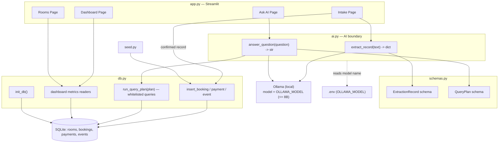
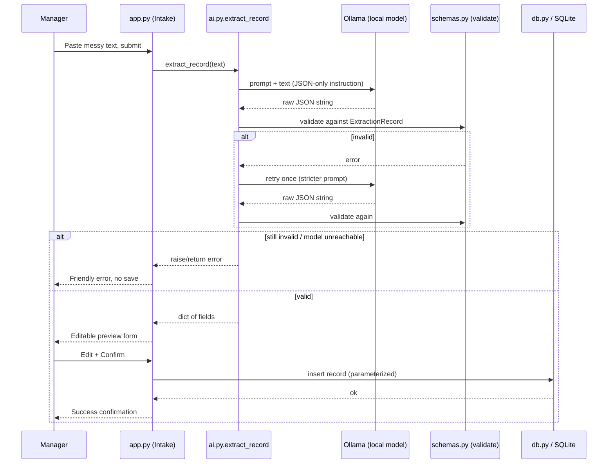
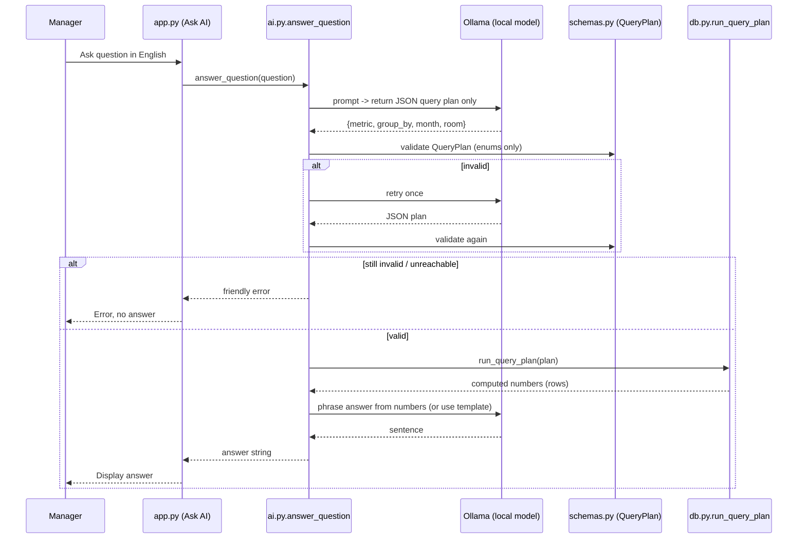

# CoworkOps AI — Design

## Overview

CoworkOps AI is a single-user Streamlit application backed by SQLite, with all AI inference performed locally through Ollama using a small open-weight model (default `qwen3:4b`, ≤ 8B parameters). The app has four pages — **Intake**, **Dashboard**, **Ask AI**, and **Rooms** — and a small set of focused modules.

The design follows two hard safety rules for AI usage:

1. **Structured extraction, human-confirmed.** The model extracts fields from pasted text; the manager reviews/edits the preview before anything is written to the database.
2. **No free-form SQL from the model.** For Ask AI, the model only produces a constrained **JSON query plan** (`metric`, `group_by`, `month`, `room`). Python executes that plan against a **whitelist of parameterized queries**. The model (or a template) only phrases the final sentence from already-computed numbers — it never touches the database directly and never emits SQL.

All model output is validated against a schema. On validation failure, the system retries **once**; if it still fails, it shows a friendly error and performs no write.

### Goals

- Keep scope minimal and demonstrable end to end within a tight build budget.
- Keep the model's authority narrow: extraction + plan selection + phrasing only.
- Keep all data local (SQLite file) and all configuration in `.env`.

### Non-Goals

See `requirements.md` → *Out of Scope*. Notably: no auth, no record editing/deleting after save, no hosted models, no model-authored SQL.

---

## Architecture

### Code Layout

```
coworkops-ai/
├── app.py            # Streamlit entrypoint; page routing + UI for 4 pages
├── db.py             # SQLite helpers: connection, schema init, whitelisted queries
├── ai.py             # Ollama calls: extract_record(), answer_question()
├── seed.py           # Seeds 5 rooms + Sept/Oct 2026 demo data
├── schemas.py        # Pydantic/jsonschema models for extraction + query plan
├── tests/            # Unit tests (schema validation, query plan execution, db queries)
├── .env.example      # OLLAMA_MODEL=qwen3:4b, OLLAMA_HOST=...
├── .gitignore        # ignores .env and the sqlite db file
├── requirements.txt  # streamlit, ollama (or httpx), pydantic, python-dotenv, pytest
├── LICENSE           # MIT
└── README.md         # setup + end-to-end demo instructions
```

> Note: `schemas.py` is a thin helper split out of the `ai.py` requirement for clarity; `ai.py` still exposes the two required functions. If a flatter layout is preferred, `schemas.py` can be folded into `ai.py`.

### Component Architecture Diagram



---

## Data Flow

### Smart Intake Flow



### Ask AI Flow (plan → whitelisted query → phrase)



The model **never** receives database write access and **never** produces SQL. Its only outputs are (a) extracted fields and (b) a query plan drawn from fixed enums.

---

## Components and Interfaces

### `ai.py`

Exposes exactly the two required functions:

```python
def extract_record(text: str) -> dict:
    """
    Call Ollama to extract structured fields from messy text.
    Returns a validated dict with keys:
      record_type, name, room, date, start_time, end_time,
      amount, payment_status, event_name
    Missing/unknown fields are None (never fabricated).
    Raises AIError on model-unreachable or after a failed retry.
    """

def answer_question(question: str) -> str:
    """
    1. Ask model for a JSON query plan (validated against QueryPlan schema).
    2. Execute plan via db.run_query_plan (whitelisted, parameterized).
    3. Phrase the answer from the computed numbers (template or model).
    Raises AIError on model-unreachable or after a failed retry.
    """
```

Internal helpers (not public): `_call_ollama(prompt) -> str`, `_parse_json(raw) -> dict`, `_with_retry(fn)` (retries once).

Model name/host read from `.env` via `python-dotenv`; default `OLLAMA_MODEL=qwen3:4b`.

### `schemas.py`

Validation models (Pydantic recommended; jsonschema acceptable).

```python
RecordType = Literal["booking", "payment", "event"]
PaymentStatus = Literal["paid", "pending", None]

class ExtractionRecord(BaseModel):
    record_type: RecordType
    name: Optional[str] = None
    room: Optional[str] = None
    date: Optional[str] = None          # ISO yyyy-mm-dd when parseable
    start_time: Optional[str] = None    # HH:MM
    end_time: Optional[str] = None      # HH:MM
    amount: Optional[float] = None      # PKR
    payment_status: PaymentStatus = None
    event_name: Optional[str] = None

Metric  = Literal["total_bookings", "total_revenue", "pending_payments",
                  "room_utilization", "events", "events_by_organizer"]
GroupBy = Literal["room", "organizer", None]

class QueryPlan(BaseModel):
    metric: Metric
    group_by: GroupBy = None
    month: Optional[str] = None   # yyyy-mm; defaults to current/selected month
    room: Optional[str] = None    # must match a seeded room name if present
```

Validation failures raise, triggering the single retry in `ai.py`.

### `db.py`

```python
def get_conn() -> sqlite3.Connection
def init_db() -> None                      # create tables if absent
def insert_booking(...) / insert_payment(...) / insert_event(...)
# Dashboard readers (parameterized):
def total_bookings(month) -> int
def total_revenue(month) -> float          # sum of paid
def pending_payments(month) -> float       # sum of pending
def room_utilization(month) -> list[(room, hours)]
def upcoming_events(month) -> list[...]
def events_by_organizer(month) -> list[(organizer, count)]
# Ask AI:
def run_query_plan(plan: QueryPlan) -> list  # dispatches to the readers above only
```

`run_query_plan` is a **dispatcher over the whitelisted readers** — it maps a validated `metric` (+ optional `room`/`month`) to one fixed, parameterized query. There is no code path where model text becomes SQL.

### `seed.py`

- Seeds exactly **5 rooms** (name, capacity, hourly_rate).
- Seeds demo bookings/payments/events across **September 2026** and **October 2026**.
- Idempotent: safe to re-run (checks for existing seed before inserting).

### `app.py`

Streamlit routing via sidebar; one function per page: `page_intake()`, `page_dashboard()`, `page_ask_ai()`, `page_rooms()`. Calls `init_db()` (and optional seed) on startup. Holds the preview form state in `st.session_state`.

---

## Data Model

Minimal tables. All timestamps/dates stored as ISO strings; amounts in PKR.

```mermaid
erDiagram
    ROOMS ||--o{ BOOKINGS : "booked in"
    ROOMS ||--o{ EVENTS   : "hosted in"
    BOOKINGS ||--o| PAYMENTS : "paid by"

    ROOMS {
        integer id PK
        text    name
        integer capacity
        real    hourly_rate
    }
    BOOKINGS {
        integer id PK
        text    customer_name
        integer room_id FK
        text    date
        text    start_time
        text    end_time
        real    amount
        text    payment_status
    }
    PAYMENTS {
        integer id PK
        integer booking_id FK
        real    amount
        text    status
        text    date
    }
    EVENTS {
        integer id PK
        text    event_name
        text    organizer
        integer room_id FK
        text    date
        text    start_time
        text    end_time
    }
}
```

### Table notes

- **rooms** — seeded with 5 rows; `hourly_rate` used only for reference/estimates in MVP.
- **bookings** — carries `payment_status` (`paid`/`pending`) directly so the dashboard can compute revenue vs. pending without a mandatory join; `amount` in PKR; utilization = sum of (end_time − start_time) grouped by `room_id`.
- **payments** — optional/standalone payment records (e.g., a pasted "received 5000 for Room A"); links to a booking when known, otherwise stands alone.
- **events** — organizer-centric; feeds "upcoming events" and "events by organizer".
- Record type from intake routes to the matching table: `booking → bookings`, `payment → payments`, `event → events`.

---

## Error Handling

| Condition | Handling |
|---|---|
| Model unreachable / Ollama down | `AIError`; page shows friendly message; no write |
| Model returns non-JSON / schema-invalid | Retry **once** with stricter prompt; if still invalid → friendly error, no write |
| Empty intake text / empty question | Short-circuit before calling model; prompt user to enter text |
| Validation fails on Intake confirm | Highlight invalid field; do not save |
| Unknown room referenced in query plan | `run_query_plan` returns empty/zeroed result; UI reports "no data" |
| No data for selected month | Dashboard shows zeroed/empty metrics without error |

**Retry policy:** exactly one retry on parse/schema failure, applied uniformly to both `extract_record` and `answer_question`.

---

## Testing Strategy

Tests live in `tests/` and run with `pytest`. The model is **not** called in tests — Ollama calls are mocked/stubbed so tests are deterministic and offline.

- **schema validation** — valid extraction/plan dicts pass; malformed ones raise; retry-then-fail path surfaces `AIError`.
- **query plan execution** — each `metric` maps to the correct whitelisted reader; invalid/unknown enum never reaches SQL; parameterization holds.
- **db readers** — on a seeded in-memory SQLite DB, verify `total_bookings`, `total_revenue` (paid only), `pending_payments`, `room_utilization` (hours per room), and `events_by_organizer` for Sept/Oct 2026.
- **seed idempotency** — running `seed.py` twice does not duplicate rooms/records.

> Per project rules, tests are included because the design explicitly calls for a `tests/` directory; they stay minimal and focused on the safety-critical boundaries (schema + whitelist).

---

## Security & Configuration Notes

- `.env` holds `OLLAMA_MODEL` (default `qwen3:4b`) and optional `OLLAMA_HOST`; `.env` and the SQLite file are git-ignored.
- No secrets in the repository; `.env.example` documents required keys.
- The model has no SQL authority and no filesystem/DB access — the only DB touchpoints are Python's parameterized, whitelisted queries.
- All AI runs locally via Ollama with a model ≤ 8B parameters.
